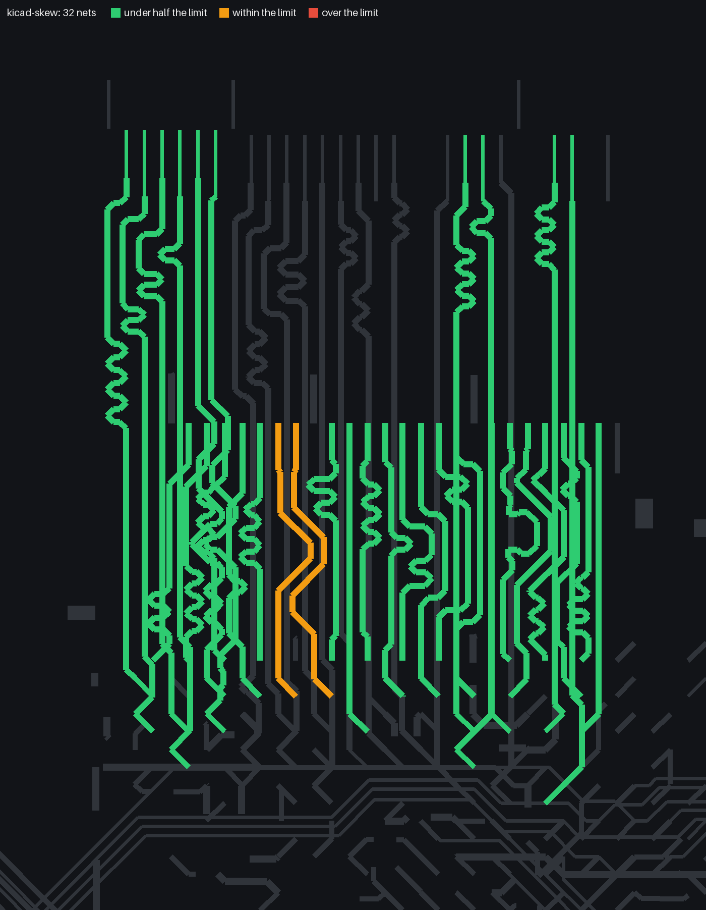
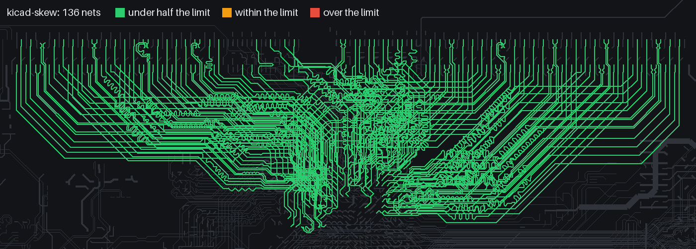

# kicad-skew

Length and skew checks for KiCad boards, on the lengths KiCad itself computes: tracks, arcs and the via barrel
between the layers a net actually uses. It also tells you when a differential pair's two legs run on different layers.

## Example: an open-source board

[Antmicro's LPDDR4 test board](https://github.com/antmicro/lpddr4-test-board) (Apache-2.0; commit 5c8b5d3): an 8-layer Kintex-7 FPGA board with an LPDDR4 SO-DIMM socket. The rules for its x16 memory channel are in `examples/antmicro-lpddr4-test-board.json`: strobe and clock
pairs within 12 mil, each byte lane and the command/address group within 1 mm of their strobe or clock, strobes
within 1200 mil of the clock.

```bash
git clone https://github.com/antmicro/lpddr4-test-board
kicad-skew lpddr4-test-board/lpddr4-test-board.kicad_pcb examples/antmicro-lpddr4-test-board.json --layers --map skew.png
```

```
measured 32 nets (KiCad lengths: tracks + via barrels between the layers used)
  P/N                  worst DQ_S1_P vs DQ_S1_N: -0.242 mm (80 % of 0.305)
  byte 0               worst DQ05_A vs mean(DQ_S0_N, DQ_S0_P): +0.017 mm (2 % of 1.000)
  byte 1               worst DQ09_A vs mean(DQ_S1_N, DQ_S1_P): +0.132 mm (13 % of 1.000)
  CA vs CK             worst CA5_A vs mean(CK_A_N, CK_A_P): +0.008 mm (1 % of 1.000)
  DQS0 vs CK           worst mean(DQ_S0_N, DQ_S0_P) vs mean(CK_A_N, CK_A_P): -11.333 mm (37 % of 30.480)
  DQS1 vs CK           worst mean(DQ_S1_N, DQ_S1_P) vs mean(CK_A_N, CK_A_P): -11.452 mm (38 % of 30.480)
PASS: 0 of 31 relations out of tolerance; 0 pairs split across layers
```

Antmicro tuned this one tightly: every byte lane is within 0.14 mm of its strobe and the command/address group within
0.01 mm of the clock, measured the way KiCad measures. The strobes sit about 11 mm short of the clock, which LPDDR4's
write leveling absorbs. With `--map`, every measured net is drawn on the board in the colour of its worst relation;
the amber pair is DQS1, whose legs differ by 0.24 mm (80 % of the 12 mil limit):



## Example: a 72-bit DDR4 channel

[Antmicro's DDR4 RDIMM tester](https://github.com/antmicro/data-center-dram-tester) (Apache-2.0; commit e7c85eb): a
12-layer Kintex-7 board that drives a registered DDR4 module, 64 data bits plus 8 check bits, each nibble with its
own strobe. The rules in `examples/antmicro-ddr4-rdimm-tester.json` hold every nibble to 1 mm of its strobe
(DQS0-8 for the lower nibbles, DQS9-17 for the upper), command and address to 1 mm of CK0, and every pair to 12 mil:

```bash
git clone https://github.com/antmicro/data-center-dram-tester
kicad-skew data-center-dram-tester/data-center-rdimm-ddr4-tester.kicad_pcb examples/antmicro-ddr4-rdimm-tester.json --layers --map skew.png
```

```
measured 136 nets (KiCad lengths: tracks + via barrels between the layers used)
  P/N                  worst DQS10_P vs DQS10_N: -0.077 mm (25 % of 0.305)
  DQS0                 worst DQ3 vs mean(DQS0_N, DQS0_P): +0.019 mm (2 % of 1.000)
  DQS9                 worst DQ4 vs mean(DQS9_N, DQS9_P): +0.057 mm (6 % of 1.000)
  ...
  DQS17                worst CB5 vs mean(DQS17_N, DQS17_P): +0.056 mm (6 % of 1.000)
  CA vs CK0            worst BG1 vs mean(CK0_N, CK0_P): +0.029 mm (3 % of 1.000)
PASS: 0 of 116 relations out of tolerance; 0 pairs split across layers
```

Every nibble and the command/address group is inside 6 % of its limit: no nibble is more than 0.06 mm from its
strobe. The worst pair is at 25 %: DQS10's legs differ by 0.077 mm against the 12 mil limit. These numbers include the FPGA's package. Antmicro entered each pin's package length on the board (KiCad's pad-to-die
length, 9.6 to 25.7 mm here), and KiCad adds it to every length it reports. On this board KiCad's length is the
track length, plus the package length, plus 0.5 to 2.9 mm for the two vias on each net (the board is 1.74 mm
thick), so nothing else is hiding in it. Matching on track length alone would have been off by up to 16 mm.



## Side by side

<table>
<tr><th>Antmicro LPDDR4 test board: x16 channel</th><th>Antmicro DDR4 tester: 72-bit channel</th></tr>
<tr><td></td>
<td></td></tr>
<tr><td>31 relations, all pass; DQS1 pair amber at 80 % of its 12 mil limit</td><td>116 relations, all pass; worst at 25 % of its limit</td></tr>
</table>

## Why we wrote it

KiCad's own DRC skew rules only check the spread inside a group. On an LPDDR4 layout we also had to check DQ against
its strobe, command/address against the clock, and strobe against clock, so we wrote our own checker. Its first
version added a flat 0.5 mm per via. It reported four pairs out of tolerance; KiCad's own lengths said every
relation passed. On an 8-layer board the flat model was off by up to about 1.1 mm per via, because KiCad counts the
barrel actually travelled between the two layers in use. So this tool does not model lengths at all: it asks KiCad.

The second lesson came from review. All 68 relations passed on length, yet four of the six clock and strobe pairs had
their legs on different inner layers, one leg on an embedded microstrip and the other on a stripline. They matched in
millimetres, not in picoseconds, and they were not coupled. `--layers` reports exactly that.

## How it measures

The board is copied to a scratch directory with a rules file that gives every selected net a 0.001 mm maximum
length. `kicad-cli pcb drc` runs, and each net's actual length is read back from its length violation. The result is
the number KiCad's length tuner shows, including via barrels from the board's stack-up and any pad-to-die lengths.

## Rules

Rules are JSON (see `examples/`). Lengths are in mm, or mil with `"unit": "mil"`. Net selectors are regexes searched
in the full net name.

| type | checks |
|---|---|
| `pairs` | each net matching `match` against its partner (`p` replaced by `n`): N minus P |
| `group` | each member against the mean of the reference nets (DQ against its DQS pair, CA against CK) |
| `spread` | max minus min over the members |
| `between` | mean of `a` minus mean of `b` (DQS against CK) |

A net that is selected but unrouted counts as a failure, not a pass.

## Install and run

```bash
pip install git+https://github.com/firedanceio/kicad-skew
kicad-skew board.kicad_pcb examples/lpddr4-rockchip.json
```

It needs `kicad-cli` (KiCad 8 or newer; developed on KiCad 10): found through `--kicad-cli`, `KICAD_CLI`, `PATH` or the
usual install locations. The `--layers` check also needs KiCad's `pcbnew` module, so run that one with KiCad's Python:

```bash
"/Applications/KiCad/KiCad.app/Contents/Frameworks/Python.framework/Versions/Current/bin/python3" -m kicad_skew board.kicad_pcb rules.json --layers
```

`--map out.png` draws the measured nets on the board, coloured by their worst relation (needs Pillow). It zooms to
the measured nets; `--map-full` shows the whole board.

Exit status: 0 everything within tolerance, 1 a failure or a split pair, 2 an error.

## Limits

Board copper only: package (die-to-ball) delays are not included unless you put them on the pads as pad-to-die
lengths. Length is not time. Legs on different layers, or nets on layers with different dielectrics, need a
time-domain check; `--layers` tells you where that applies.

The example limits in `examples/lpddr4-rockchip.json` come from Rockchip's RK3568 high-speed PCB guide. Check your
own SoC's guide.

## Validation

What we tested before release, on which boards, and what it turned up: [VALIDATION.md](VALIDATION.md).

## License

Apache 2.0. Made by [Firedance](https://firedance.io).
